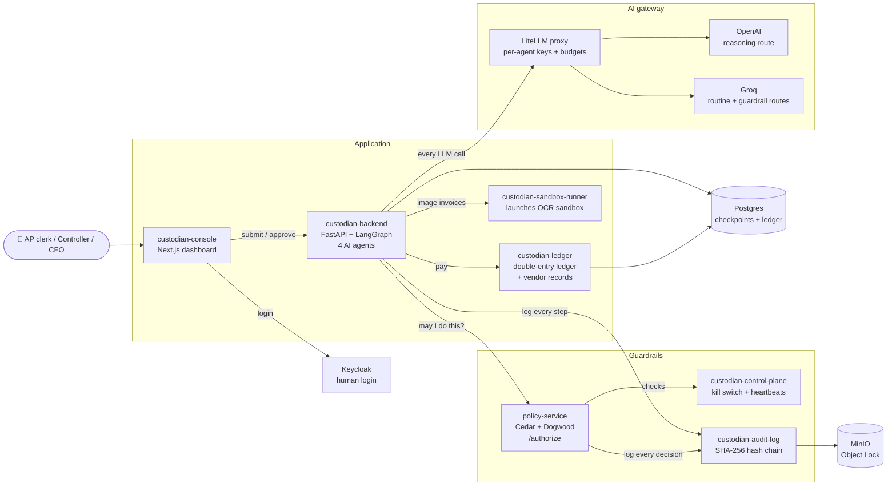
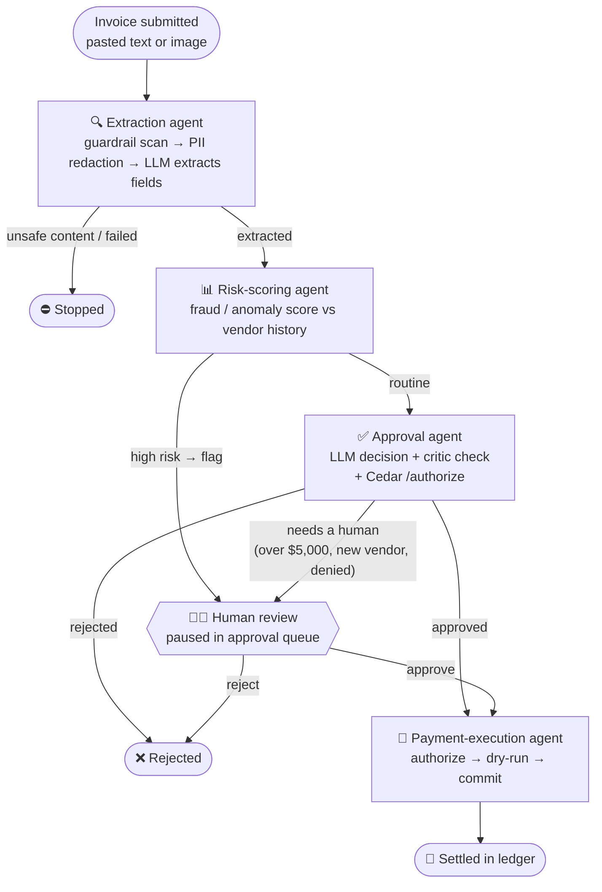
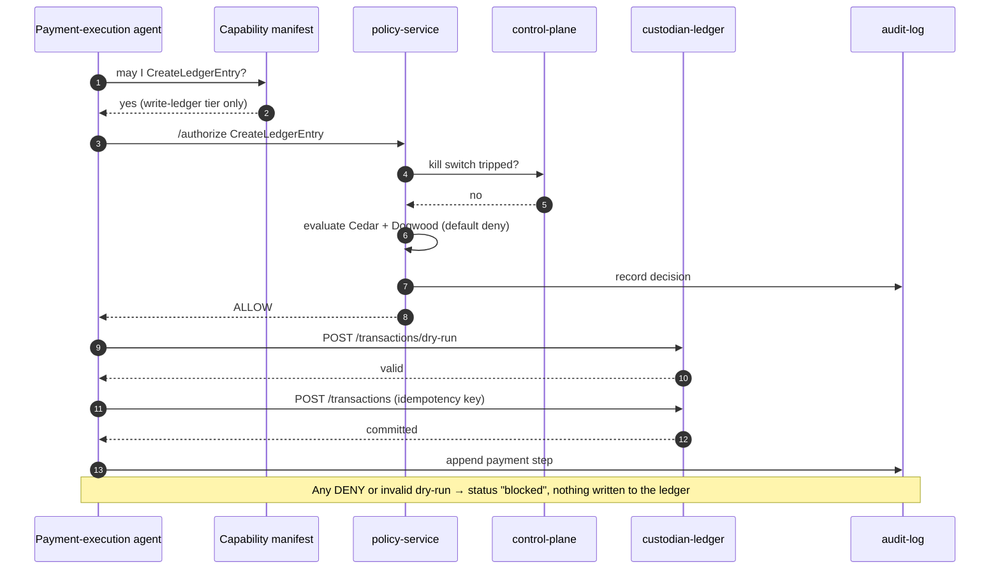
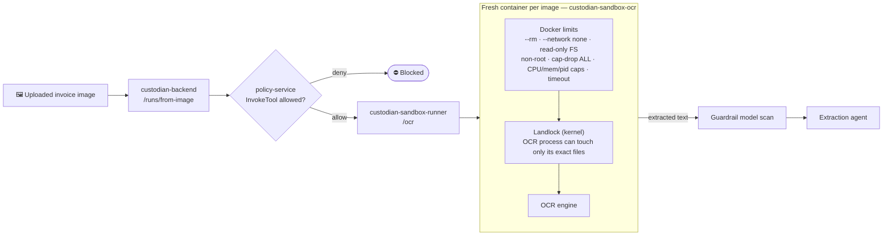
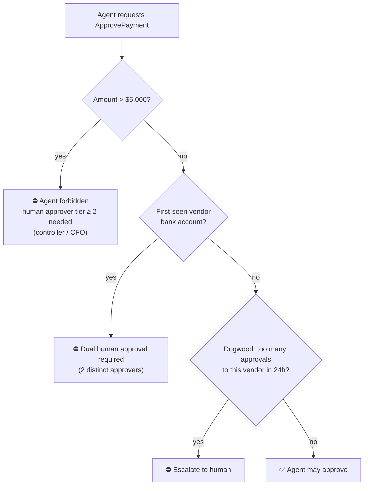
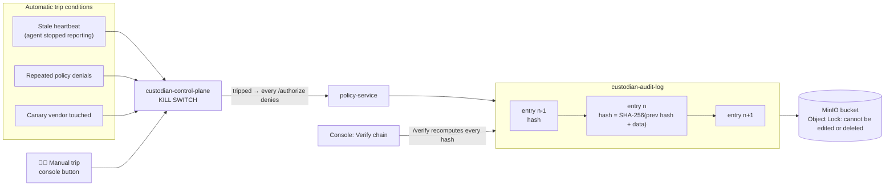

# Custodian — Architecture Diagrams

Visual guide to how Custodian works. Every diagram below renders directly on
GitHub (Mermaid). The original hand-drawn board is `Custodian.excalidraw` in
the repo root — open it at [excalidraw.com](https://excalidraw.com) (menu → Open).

1. [The big picture](#1-the-big-picture)
2. [The agent pipeline](#2-the-agent-pipeline-one-invoice-start-to-finish)
3. [The six governance layers](#3-the-six-governance-layers)
4. [What happens before money moves](#4-what-happens-before-money-moves)
5. [Sandboxed OCR for invoice images](#5-sandboxed-ocr-for-invoice-images)
6. [Approval rules (Cedar + Dogwood)](#6-approval-rules-cedar--dogwood)
7. [Kill switch and tamper-proof audit log](#7-kill-switch-and-tamper-proof-audit-log)

---

## 1. The big picture

A human submits an invoice in the console. Four AI agents process it inside
the backend. Every consequential action is checked by the policy service,
and everything is written to an audit log that can prove what happened.

---

## 2. The agent pipeline (one invoice, start to finish)

The four agents are nodes in one LangGraph graph, checkpointed in Postgres.
A human-review pause is a real `interrupt()` — the run waits durably until
someone approves or rejects in the console.

Run states follow the A2A vocabulary: `extracted` → `risk_scored` →
`pending_human` / `approved` → `settled` (or `failed` / `rejected`).

---

## 3. The six governance layers

```mermaid
flowchart TB
    subgraph L1["Layer 1 · Identity"]
        direction LR
        kc["Keycloak<br/>who is the human + role"]
        spire["SPIRE<br/>crypto ID per agent/service"]
        inf["Infisical<br/>secrets vault"]
    end
    subgraph L2["Layer 2 · Data"]
        direction LR
        om["OpenMetadata<br/>catalog + sensitivity tags"]
        pres["Presidio<br/>strips PII before audit"]
        gx["Great Expectations<br/>validates loaded data"]
    end
    subgraph L3["Layer 3 · Model"]
        direction LR
        ll["LiteLLM<br/>one gateway, per-agent budget caps"]
        mlf["MLflow<br/>prompt versions"]
        de["DeepEval<br/>pass/fail prompt quality gate"]
    end
    subgraph L4["Layer 4 · Policy"]
        direction LR
        cedar["Cedar<br/>static rules"]
        dw["Dogwood<br/>rules over time"]
    end
    subgraph L5["Layer 5 · Agent Runtime"]
        direction LR
        lg["LangGraph<br/>orchestration"]
        gr["Guardrail model<br/>prompt-injection + fraud text"]
        cap["Capability manifests<br/>second permission check"]
        sb["Sandboxed OCR<br/>Docker + Landlock"]
        ks["Kill switch"]
    end
    subgraph L6["Layer 6 · Operations"]
        direction LR
        otel["OpenTelemetry"]
        lf["Langfuse<br/>LLM traces + cost"]
        prom["Prometheus + Grafana"]
        al["Tamper-proof audit log"]
    end

    L1 --> L2 --> L3 --> L4 --> L5 --> L6
```

| Layer | Question it answers | Tools |
|---|---|---|
| 1 Identity | *Who* is acting — human or agent — and can it be faked? | Keycloak, SPIRE, Infisical |
| 2 Data | Is the data clean, catalogued, and PII-safe? | OpenMetadata, Presidio, Great Expectations |
| 3 Model | Which model/prompt is used, at what cost, and is it good enough? | LiteLLM, MLflow, DeepEval |
| 4 Policy | Is this action *allowed*? | Cedar, Dogwood |
| 5 Agent Runtime | Is the agent behaving safely right now? | LangGraph, guardrail, manifests, sandbox, kill switch |
| 6 Operations | Can we see and *prove* what happened? | OpenTelemetry, Langfuse, Prometheus, Grafana, audit log |

---

## 4. What happens before money moves

The payment-execution agent must pass **two independent permission checks**
(capability manifest + Cedar) and a **ledger dry-run** before anything is
committed. Either check alone denying is enough to block.

---

## 5. Sandboxed OCR for invoice images

Invoice images are untrusted. Each one is read in a brand-new, locked-down
container that is thrown away afterwards.

---

## 6. Approval rules (Cedar + Dogwood)

Files in `policies/`. Everything is **denied by default**; these rules carve
out what is allowed and force escalation where it matters.

| File | Rule |
|---|---|
| `01-agent-approval-threshold.cedar` | No agent may approve a payment over $5,000 |
| `02-first-seen-vendor-dual-approval.cedar` | New vendor bank account → two human approvals |
| `03-payment-execution-exclusive-ledger-write.cedar` | Only the payment-execution agent may write to the ledger |
| `04-tool-allowlist.cedar` | Each agent may call only its listed tools |
| `05-flagging-and-documentation-actions.cedar` | Who may flag for review / request docs / update vendors |
| `temporal/05-vendor-approval-rate-limit.dw` | Pattern-over-time limit on approvals per vendor |

---

## 7. Kill switch and tamper-proof audit log

If anyone edits an old audit entry, its hash no longer matches the next
entry's `prev hash`, and `/verify` reports exactly where the chain broke.
